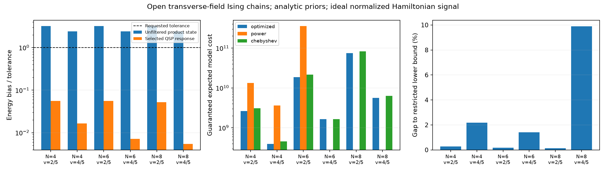

# 物性への応用試験：横磁場イジング鎖

2026-10-27。既存の抽象スペクトル実験に対して、物理模型から作る応用例を追加した。本資料は初回の応用試験を詳述する。現在は有限サンプリング拡張とともに日英本文にも統合した。初回の数値データを保全し、新しい有限予算結果とは区別する。

## 問いと結果

**簡単に準備できる積状態から出発して基底エネルギーを求めるとき、事前情報だけで選んだフィルタは誤差を減らし、再試行まで含む費用を抑えられるか。**

開放端の横磁場イジング模型

\[
H=-\sum_{i=1}^{N}X_i-J\sum_{i=1}^{N-1}Z_iZ_{i+1},\qquad
|\psi\rangle=|+\rangle^{\otimes N}
\]

について、`N=4,6,8`、総相互作用ノルム境界 `v=(N-1)J=0.4,0.8` の6条件を実行した。真の固有値・固有ベクトルはフィルタ選択の後だけ計算した。

| スピン数 | v | 目標絶対誤差 | フィルタなしのバイアス | 選択QSP後のバイアス | 選択次数 | 費用上界 / 制限最適下界 |
|---|---|---|---|---|---|---|
| 4 | 0.4 | 0.004167 | 0.013338 | 0.000233 | 5 | 1.00286 |
| 4 | 0.8 | 0.022222 | 0.053411 | 0.000368 | 7 | 1.02186 |
| 6 | 0.4 | 0.002500 | 0.008002 | 0.000139 | 6 | 1.00173 |
| 6 | 0.8 | 0.013333 | 0.032031 | 0.000096 | 8 | 1.01401 |
| 8 | 0.4 | 0.001786 | 0.005715 | 0.000093 | 7 | 1.00124 |
| 8 | 0.8 | 0.009524 | 0.022871 | 0.000052 | 10 | 1.09888 |

全6条件で最適化応答が選択された。初期積状態の平均エネルギーは目標精度を満たさず、選択後は全条件で満たした。比較したChebyshev型の費用保証は選択応答の1.001–1.173倍。power型が証明書を得た3条件では5.03–19.02倍であり、残り3条件では次数16以内の試した候補に証明書が得られなかった。これはpower型一般の不可能性ではない。Chebyshevのパラメータも既存実験と同じ有限集合で、全てのチューニングに勝ったとは主張しない。

保証費用は約3.93億–744.8億のモデル単位であり、実用上の高速化は示していない。独立なBernoulli集約サンプリングは各200回、計1,200回で目標精度違反0。ただし信頼度95%の保証は濃度不等式に由来する。



## 真値を使わない事前情報

`H0=-sum X` の基底状態は上の積状態、基底エネルギーは `-N`。`Q=I-|psi><psi|` と置く。`v<2` で

\[
QHQ\succeq(-N+\Delta)Q,\quad \Delta=2-v,\qquad
t^2=\|QV\psi\|^2=(N-1)J^2=\frac{v^2}{N-1}.
\]

異なる結合の `ZZ|psi>` はX基底で直交するため、最後の等式が得られる。変分原理から `E0<=-N`。基底状態を `c|psi>+q` と分解し、直交ブロックの固有方程式を解くと

\[
q=-(QHQ-E_0)^{-1}QV\psi\,c,
\quad -N-E_0\leq t^2/\Delta,
\quad \|q\|\leq(t/\Delta)|c|.
\]

したがって、真の対角化を使わず

\[
d=t^2/\Delta,\quad L=-N-d\leq E_0\leq U=-N,\qquad
|\langle\psi|E_0\rangle|^2\geq a=\frac{1}{1+t^2/\Delta^2}
\]

が得られる。実験では `R=N+v`、`T=R-L`、`G=(H-LI)/T` としてスペクトルを `[0,1]` に正規化し、`u=d/T`、正規化平均誤差 `E=u/8` を使った。物理エネルギーの目標誤差は `T E=d/8`。事前区間の中点の保証誤差 `d/2` は目標の4倍なので、事前情報だけで解けた例ではない。

この事前情報の導出には既知の非相互作用模型のギャップを使う。フィルタ選択には相互作用模型の真のギャップを入力しないが、この弱結合実験そのものはgap-free手法の優位性を検証した例ではない。

## Hamiltonianへの写像と費用の範囲

元論文はGram演算子の平均を扱う。今回のエネルギー応用では、同じスカラー定理を `G` に適用し、信号を `Y=2G-I` に変えた。平方根Hamiltonianを無料で仮定して元論文の実装をそのまま使ったものではない。

係数 `c_k` で `P(x)=sum c_k T_k(2x-1)` と書くと、`F(y)=P((y+1)/2)=sum c_k T_k(y)`。`|F|<=1` なので、偶・奇部分 `Fe,Fo` もそれぞれ `|Fe|,|Fo|<=1`。各部分を安全係数0.95でQSP合成し、Hermitian抽出・LCU平均で合成する。得られる振幅は **`0.475 P(G)`**。この1/2の受理損失を最初から選択・費用に含め、元論文の0.95の結果と混同しない。

偶・奇QSPの次数を `ne,no` とすると、直列制御実装の呼出し数は `2(ne+no)<=4n`。比較では全候補に保守的な `4n` を課し、読み出し1、準備の費用パラメータを `cpsi=N` とした。最大次数16、誤差配分は元実験と同じ有限集合 `{0.4,0.6,0.8}E`。準備費用はモデル上のquery換算値であり、実ゲート時間・物理深さの測定値ではない。

保存した偶・奇位相に対して、厳密有理Taylor区間・複素多項式漸化式・Bernstein包絡を使い、全区間の振幅誤差を検証した。最大誤差上界は `2.04e-16`、誤差配分の実装用余裕を満たす。位相誤差を含む受理下界で補正した費用上界もsummary JSONに保存し、補正比は最大約 `1+1e-15`。QSPの数値照合は各固有モードの2x2信号応答に対して行った。物理回路の実機実験ではない。

**費用のoracleは正規化したYの理想block encoding**。Pauli LCUをそのまま実装した場合の係数ノルムは `(2R+|R+L|)/T` で一般に1を超えるため、正規化を実現する追加操作・精度・ゲート費用は別途必要。Hamiltonianに落としたことだけで、その部分を検証済みとはしない。

## 研究上の位置づけと限界

横磁場イジング模型での量子フィルタ・エネルギー推定は既存である。[Dong–Lin–Tong, PRX Quantum 3, 040305 (2022)](https://arxiv.org/abs/2204.05955) にも同模型の実験がある。今回の応用名そのものを新規性とせず、解析的な事前情報から選択・受理・費用保証まで接続する検証例と位置づける。

この鎖は可解な小模型で、厳密対角化も容易。古典計算やQET-U/VQE等への優位性は示していない。また `v` を固定してサイズを変えたため `J=v/(N-1)` は変わり、目標精度も変わる。表から熱力学極限のスケーリングや臨界点性能を推論できない。

次の本格評価で価値があるのは、非可積分な縦磁場付き模型などで、初期状態の品質・精度・準備費用を変えたときの選択の変化を調べること。その際は既存QET-U等との同一oracle比較と、事前情報取得費用・LCU正規化を含む実装費用の評価が必要。この小実験だけで新しい応用アルゴリズムが完成したとは扱わない。

## 再現

```sh
OPENBLAS_NUM_THREADS=1 MPLCONFIGDIR=/tmp/qmsve-mpl .venv/bin/python experiments/selection_ising_application.py --pilot
OPENBLAS_NUM_THREADS=1 MPLCONFIGDIR=/tmp/qmsve-mpl .venv/bin/python experiments/selection_ising_application.py
MPLCONFIGDIR=/tmp/qmsve-mpl .venv/bin/python experiments/selection_ising_figures.py
```

pilotは4スピン・v=0.8の1条件。全実験は6条件、実測約1分。`results/selection_ising_application.json` に事前情報、候補、連続証明書、位相、対角化後の監査、ソースハッシュを保存。`selection_ising_summary.json` に費用補正を含む要約、`selection_ising_pilot.json` にpilotの結果がある。元論文のJSON・PDF・ZIPを上書きしない。2スピンの既知固有値 `-sqrt(4+J²)`、全6条件の事前保証・誤差・ソースハッシュも照合した。
